# Ultimate Dark Adventure

Mod de fantasia sombria para **Minecraft 1.21.1 (NeoForge)** em que tudo gira em torno do **Olho**.
Mobs, bosses, armas e armaduras têm uma forma **selada** (olhos fechados, energia contida) e uma forma
**desperta** (olhos roxos abertos, rachaduras acesas, partículas e aura). O equipamento ainda tem a
forma **suprema**, liberada no fim do jogo.

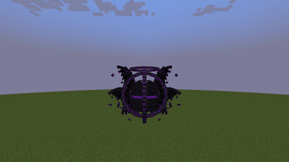

- Minecraft 1.21.1 · NeoForge 21.1.248 ou mais novo
- Vai no **cliente e no servidor**, e não precisa de nenhum outro mod
- Os jars prontos estão em [Releases](../../releases)

## Progressão

| Etapa | O que fazer | O que libera |
|---|---|---|
| 1. Cavernas profundas | Minerar o **Minério do Olho** (abaixo de y 16) | Fragmento Ocular Bruto (vira Lingote Ocular no forno) e, às vezes, Cristal Roxo Ocular |
| 2. Hollow Watchers | Lutar com eles abaixo de y 0. Um em cada dez é um **Vigia Ancestral**, maior | O Vigia Ancestral sempre deixa o **Olho do Vigia** |
| 3. Equipamento | Craftar armas, ferramentas e armadura com Lingotes Oculares | Tudo nasce **selado** |
| 4. Altar do Olho | Craftar o altar com o Olho do Vigia, pôr o item em cima e usar um **Núcleo do Olho** (+1 cristal) | Forma **desperta**: a tecla `V` abre o olho e libera o poder da arma |
| 5. Ruínas Amaldiçoadas | Derrotar o **Blind Executioner** | Olho de Agamoto, Fragmentos Abissais e o mapa do Santuário Abissal |
| 6. Núcleo Desperto | No altar: Núcleo do Olho + Fragmento Abissal (+2 cristais) | Núcleo do Olho Desperto |
| 7. Santuário Abissal | 4 Fragmentos Abissais no Altar Abissal + o Núcleo Desperto | Invoca o **Dragão Abissal**, que deixa o Coração Abissal, escamas e o mapa da Catedral |
| 8. Catedral do Vazio | Oferecer o Coração Abissal no Altar do Vazio | Invoca **O Olho Negro**, que deixa a Essência do Vazio |
| 9. Despertar supremo | No altar: Essência do Vazio (+2 Escamas Abissais) num item desperto | Forma **suprema** |

As conquistas do mod (aba "Ultimate Dark Adventure") seguem essa trilha e dizem qual é o próximo passo.

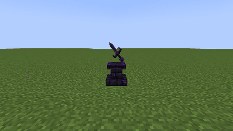

## Mobs

- **Hollow Watcher:** esqueleto negro com um núcleo ocular no peito, das cavernas profundas. Ao perder
  metade da vida, o olho se abre: atira mais rápido e com Flechas Oculares, que perseguem o alvo.
- **Blind Executioner:** pillager amaldiçoado de manto, venda nos olhos e dois machados. Cego, ele
  ouve em vez de enxergar (quem anda agachado passa despercebido). Ao perder 40% da vida, a venda cai,
  um olho roxo se abre no rosto, ele cresce e passa a girar os machados.

Todo mob desperto ganha a **Aura do Olho**: selo no chão, olhos flutuantes que piscam, faíscas sugadas
para o corpo e fumaça negra.

| Hollow Watcher desperto | Blind Executioner ascendido |
|---|---|
| 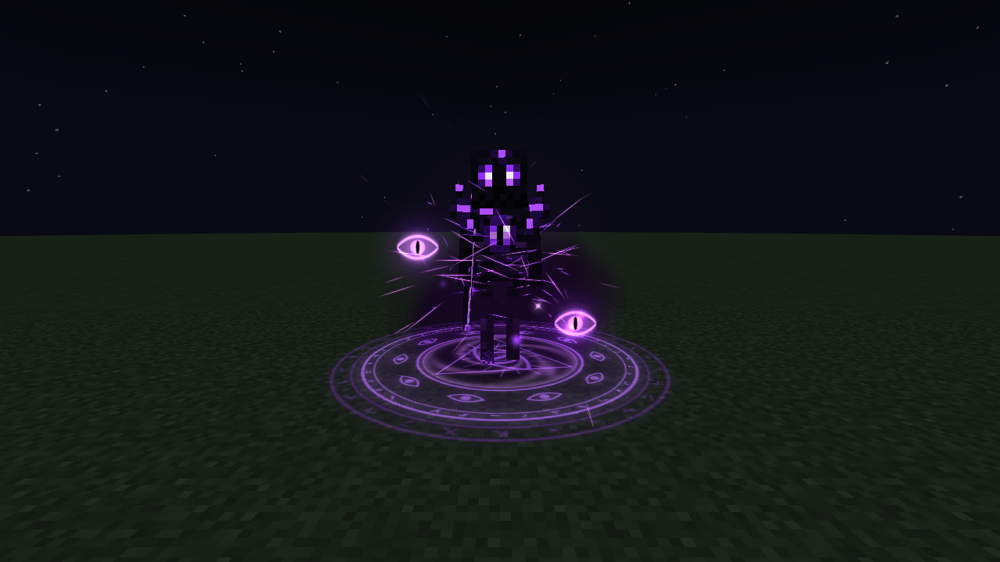 | 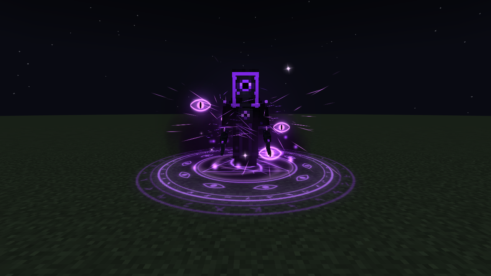 |

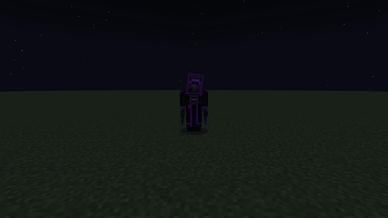

## Bosses

Os dois têm três fases: **adormecido**, **desperto** (50% da vida: onda de choque, ataques novos e
aura) e **enfurecido** (20%: barra vermelha, ataques mais rápidos e um ataque final).

- **Dragão Abissal:** voa em círculos e alterna sopro roxo (deixa poças de fogo roxo), mergulho,
  chuva de olhos e explosões oculares. Enfurecido, solta o Rugido Abissal.
- **O Olho Negro:** um olho gigante com anéis cheios de olhos, correntes e seis asas. Usa orbes que
  perseguem, raio ocular, barragem de olhos e correntes que puxam quem foge. Desperto, invoca Hollow
  Watchers; enfurecido, gira quatro raios em volta de si (Olhar Final).

| Dragão Abissal | O Olho Negro enfurecido |
|---|---|
| 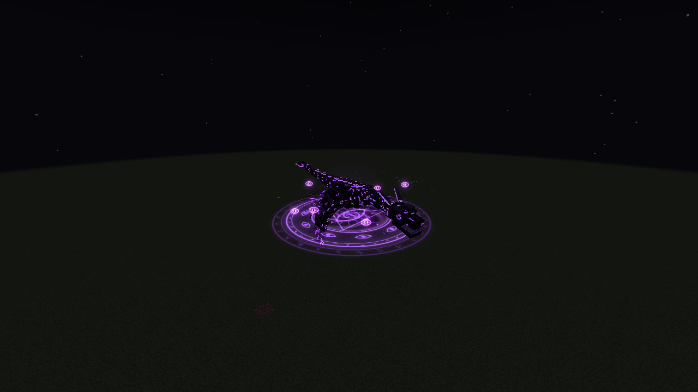 | 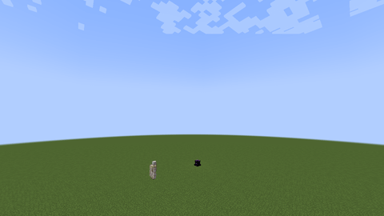 |

## Equipamento

Armas e ferramentas em **3D**. Abertas, gastam durabilidade.

| Item | Desperto | Supremo |
|---|---|---|
| Espada Ocular | +3 de dano, definha, Corte de Energia | +5 de dano, três cortes em leque |
| Machado Ocular | +3 de dano, Giro do Carrasco | giro maior, corta o dobro de rápido |
| Picareta Ocular | revela minérios através das paredes | enxerga bem mais longe |
| Pá Ocular | cava em 3x3 | cava em 5x5 |
| Arco Ocular | flechas que perseguem o inimigo na mira | flechas mais fortes, que definham |
| Escudo Ocular | Barreira Ocular: devolve projéteis da frente | barreira de todos os lados |
| Grimório do Olho | três orbes que perseguem | cinco orbes que explodem |
| Armadura Ocular | conjunto: Visão do Olho (visão noturna, inimigos marcados) | + Resistência, imune a definhamento e escuridão |
| Olho de Agamoto | Instante Congelado: quase para o tempo dos inimigos | uma vez a cada 5 minutos, volta o tempo quando você morreria |

| Armas no escuro (fechadas em cima, abertas embaixo) | Primeira pessoa |
|---|---|
| 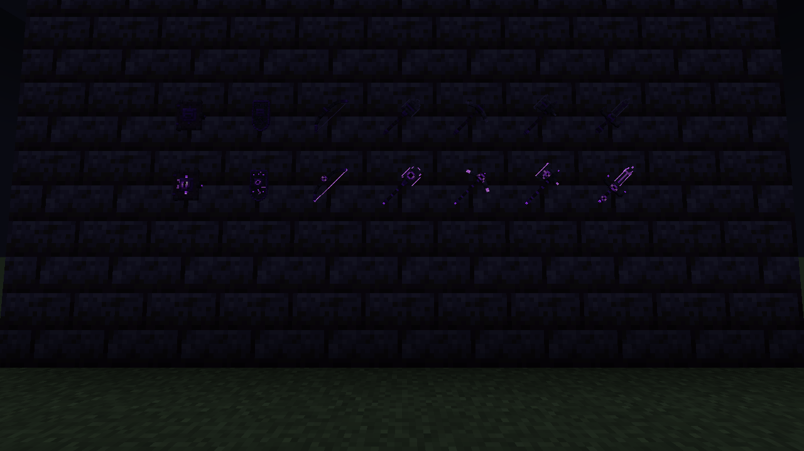 | 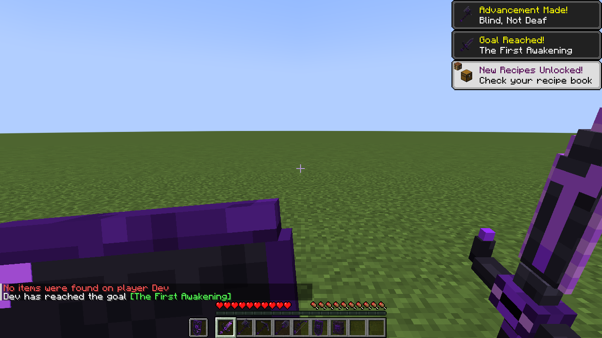 |
| **Corte de Energia supremo** | **Picareta: minérios pela parede** |
| 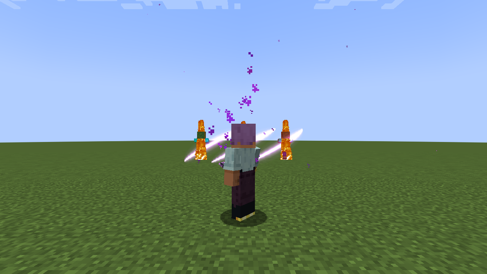 | 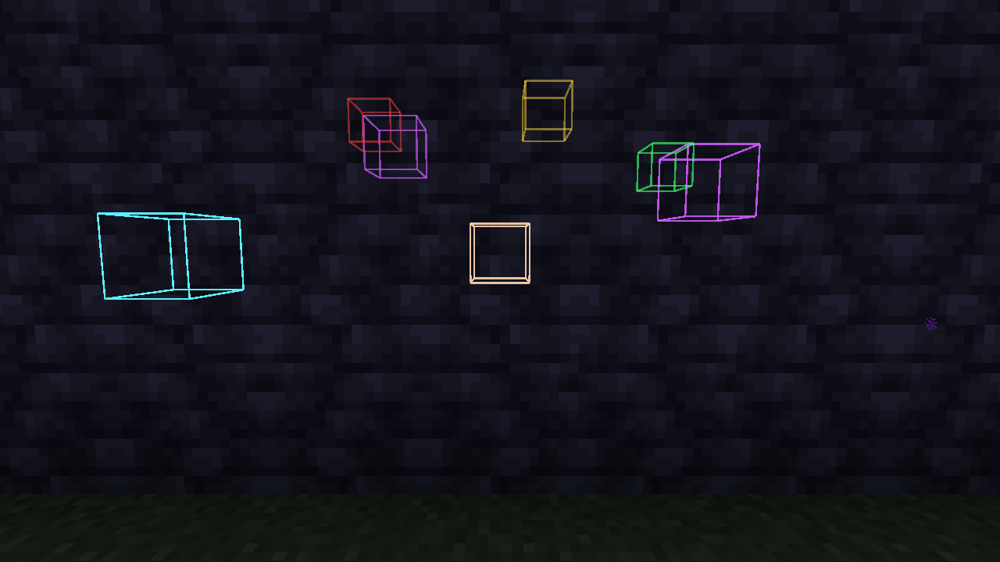 |
| **Armadura: selada, desperta e suprema** | **Invocação do Olho Negro** |
| 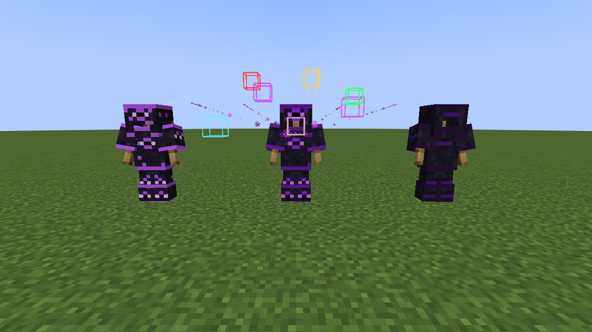 | 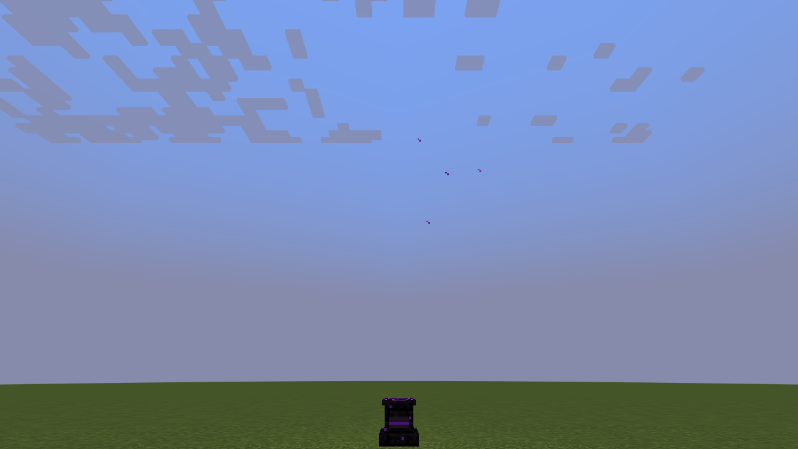 |

## Estruturas

- **Ruínas Amaldiçoadas:** muros de pedra negra com olhos, baú e o Blind Executioner.
- **Santuário Abissal:** plataforma de obsidiana com pilares e o Altar Abissal.
- **Catedral do Vazio:** nave de ardósia com vitrais roxos e o Altar do Vazio na abside.

O Executioner e o dragão deixam mapas que levam à estrutura seguinte.

| Ruínas Amaldiçoadas | Santuário Abissal |
|---|---|
| 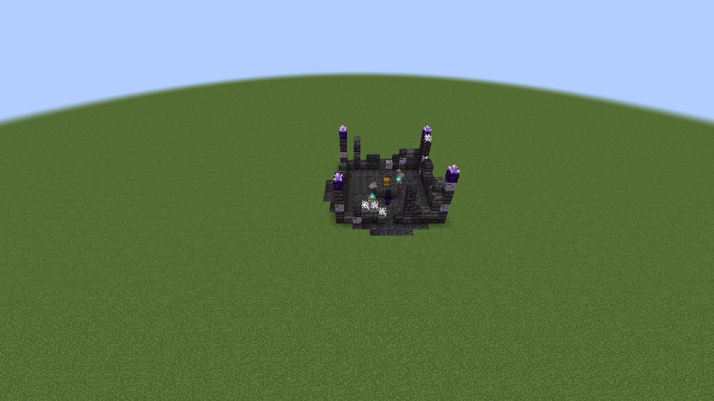 | 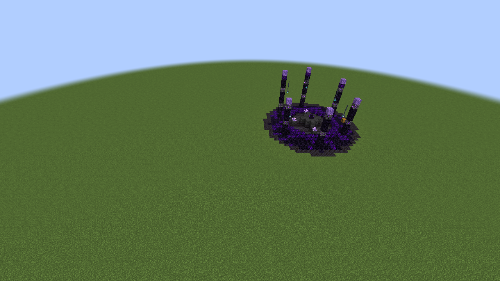 |

## Interface

O mod traz um pacote de recursos embutido, **Ultimate Dark Adventure** ("O Olho te observa..."), que
deixa a interface preta e roxa: inventário e containers com o olho em cima do painel, botões, hotbar,
corações e barra de XP roxos, tooltips, avisos, conquistas, panorama da tela de título, logo no menu de
pausa, tela de carregamento com o Olho e barra própria para os bosses do mod. Ao lado da hotbar, um
olho mostra o estado da arma na mão (selada, fechada, aberta ou suprema) e a recarga do poder.

Ele já vem ligado na primeira vez que o jogo abre com o mod. Para desligar, é só tirar em
Opções → Pacotes de recursos; o mod respeita a escolha depois disso.

| Menu de pausa | Inventário |
|---|---|
| 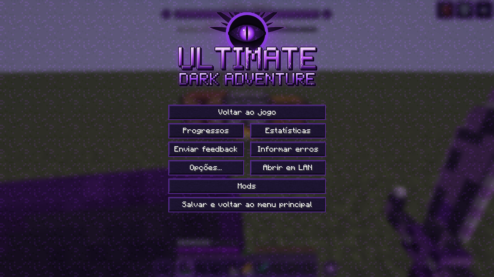 | 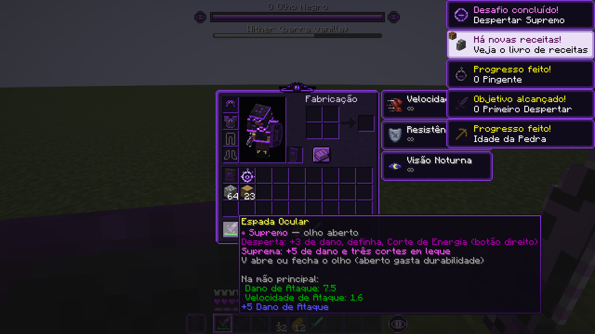 |
| **Carregando o mundo** | **HUD com a barra de boss** |
| 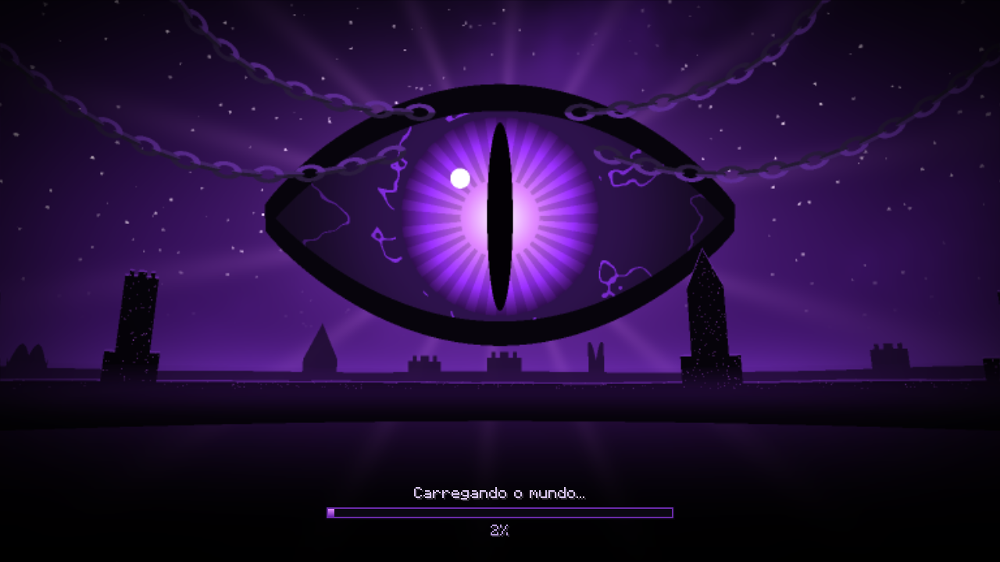 | 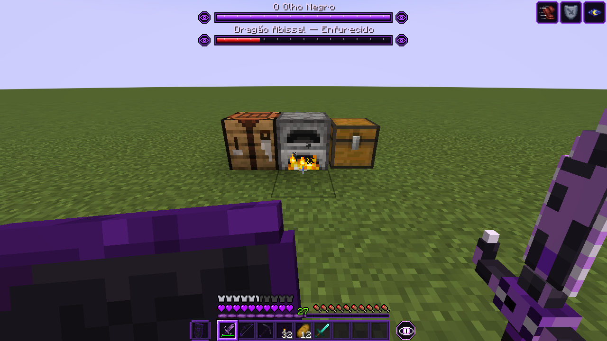 |

## Instalação

Coloque o jar na pasta `mods` do **cliente e do servidor**. Só precisa do NeoForge.

A tecla `V` abre e fecha o olho da arma na mão (dá pra trocar em Opções → Controles).

## Compilar

Precisa de JDK 21.

```bash
./gradlew build
```

O jar sai em `build/libs/`. `./gradlew runScreenshots` abre o jogo, monta as cenas de teste e tira
os prints (`-PcenaInicial=4000` roda só a parte da progressão; `-PcenaInicial=6000`, só a interface).

As texturas, os modelos e os dados são gerados por scripts (Node 18+ e Java 21), não editados à mão:

| Script | Gera |
|---|---|
| `tools/texturas/gerar_texturas.mjs` | texturas dos mobs |
| `tools/modelos/gerar_modelos.mjs` | modelos 3D das armas (selado, desperto e supremo) |
| `tools/bosses/gerar_bosses.mjs` | geometria e texturas dos bosses |
| `tools/itens/gerar_itens.mjs` | itens, blocos e armadura |
| `tools/dados/gerar_dados.mjs` | traduções, sons, receitas, drops, estruturas e conquistas |
| `tools/aura/GerarAtlasAura.java` | atlas de efeitos da aura |
| `tools/interface/gerar_interface.mjs` | pacote da interface (recolore as texturas do jar do Minecraft), panorama, logo e peças do HUD |

## Créditos

- O motor da aura é adaptado do mod **Auras**, do mesmo autor.
- Os sons são arquivos do próprio Minecraft, combinados e reafinados.
- Projeto de fã, sem vínculo com a Mojang ou a Microsoft.
